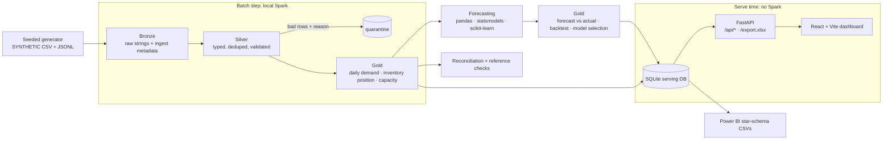

# Aapurti: supply-chain analytics platform

PySpark medallion pipeline, time-series forecasting with honest backtests, validation against hand-computed "approved" values,
a FastAPI backend, a React dashboard, an Excel export with live formulas, Databricks notebooks and a Power BI model kit.

> **All data in this project is SYNTHETIC.** It comes from a seeded generator (`src/aapurti/generator.py`): plants, SKUs,
> suppliers, daily demand (trend + weekly and annual seasonality + noise + promo spikes), inventory movements and machine
> capacity by line. It is not real company data and nothing here describes a real business.

* **Repo:** https://github.com/HxrshRaj/Aapurti
* **Live demo:** _not yet deployed, see [Publishing](#publishing-and-live-demo)_

## What it demonstrates

Python, SQL-style transformations in PySpark, ETL (bronze / silver / gold), data validation with a quarantine table,
time-series forecasting (baselines, Holt-Winters, gradient boosting) with rolling-origin backtesting, validation of pipeline
output against approved calculations, a REST API, a dashboard, and Excel / Power BI-ready reporting, in a supply-chain and
manufacturing setting (forecasting, inventory visibility, capacity planning).

## Architecture



Spark runs only in the **batch step**. The deployed demo reads pre-computed gold tables from a ~5 MB SQLite file, so it needs
no Spark cluster and no Java.

```
src/aapurti/
  generator.py            seeded synthetic data (+ deliberately corrupted rows)
  pipeline/               bronze.py silver.py gold.py run.py session.py  (plain PySpark, small testable functions)
  forecasting/            models.py backtest.py metrics.py run.py
  validation/             reference.py (approved values)  reconcile.py (source -> gold)
  calcs.py                the approved business formulas in pure Python
  serving.py              gold -> SQLite + Power BI exports
  excel.py                openpyxl workbook with real formulas
  api/main.py             FastAPI
databricks/               notebooks (.py source format) that call the same modules
reference/                hand-computed expected values + fixture dataset
powerbi/                  star-schema exports, DATA_MODEL.md, measures.dax, build instructions
frontend/                 React + Vite + TypeScript dashboard, Vitest tests
tests/                    pytest suite
scripts/run_all.py        generate -> pipeline -> forecast -> reconcile -> serving DB + Power BI exports
```

## Results (all from a real run on this repo's code)

Generated dataset (seed 42, 2023-01-01 to 2025-12-31): 3 plants, 48 SKUs, 8 suppliers, 9 production lines, 75 SKU-plant demand
series. Raw rows: 82,528 demand, 85,992 inventory movements, 9,864 capacity. About 2% of rows were deliberately corrupted.

### Pipeline run time

Local Spark 3.5.3 (`local[*]`, 2 GB driver), Parquet, Ubuntu 24.04 under WSL2 on a 12-thread laptop, with the repo on a Windows
drive mounted into WSL (`/mnt/c`, slow IO, so treat these as pessimistic):

| Stage | Seconds |
|---|---:|
| Bronze (ingest 8 files) | 33.6 |
| Silver (type, validate, quarantine) | 41.8 |
| Gold (3 tables) | 16.0 |
| **Spark pipeline total** | **91.4** |
| Forecasting backtest + final forecasts (75 series x 5 models x 7 origins) | 448.9 |
| Data generation | 3.9 |

Row counts after the run: silver 80,556 demand / 84,639 movements / 9,834 capacity; quarantined 1,972 / 1,353 / 30.

### Backtest: forecast accuracy by model

Rolling-origin evaluation: 6 origins, each forecasting the next 28 days (origins 2025-07-16 ... 2025-12-03, last window ends
2025-12-31), every model refit at every origin using only data up to the origin. 12,600 forecast points per model. Lower is
better. Groups are SKU volume classes (A = high, B = medium, C = low volume).

| Class | Model | MAPE | WAPE | RMSE | Series where it loses to naive | Series where it loses to best baseline |
|---|---|---:|---:|---:|---:|---:|
| A | **gradient_boosting** | 13.0% | **12.5%** | 60.0 | 0% | 0% |
| A | holt_winters | 19.8% | 20.1% | 118.1 | 0% | **22%** |
| A | seasonal_naive | 21.2% | 22.2% | 127.1 | 11% | n/a (baseline) |
| A | moving_average | 28.8% | 24.8% | 121.4 | 6% | n/a |
| A | naive | 37.2% | 31.3% | 159.0 | n/a | n/a |
| B | **gradient_boosting** | 15.1% | **14.0%** | 19.7 | 0% | 0% |
| B | holt_winters | 18.0% | 17.4% | 27.0 | 0% | 5% |
| B | seasonal_naive | 21.6% | 21.0% | 31.5 | 0% | n/a |
| B | moving_average | 29.7% | 24.4% | 34.4 | **14%** | n/a |
| B | naive | 38.4% | 31.2% | 45.8 | n/a | n/a |
| C | **gradient_boosting** | 29.8% | **22.5%** | 5.2 | 0% | 0% |
| C | holt_winters | 32.4% | 25.6% | 6.2 | 0% | 0% |
| C | moving_average | 43.6% | 31.4% | 7.5 | 3% | n/a |
| C | seasonal_naive | 39.3% | 32.6% | 8.0 | **17%** | n/a |
| C | naive | 57.2% | 40.3% | 9.6 | n/a | n/a |
| All | gradient_boosting | 21.7% | 13.6% | 31.4 | 0% | 0% |
| All | holt_winters | 25.4% | 19.8% | 59.7 | 0% | 7% |
| All | seasonal_naive | 30.0% | 22.7% | 64.7 | 11% | n/a |
| All | moving_average | 36.1% | 25.2% | 62.4 | 7% | n/a |
| All | naive | 47.2% | 31.9% | 81.8 | n/a | n/a |

MAPE excludes zero-demand days (undefined), so WAPE is the headline metric. Winner per class (chosen from these results, not by
assumption): **gradient boosting for A, B and C**. Full table: `powerbi/data/backtest_results.csv`.

**Where models lose** (this is the point of reporting per-series losses):

* A model beating the naive baseline *on average* does not mean it wins on every series. `seasonal_naive` is worse than plain `naive`
  on 17% of class-C series and 11% of class-A series. `moving_average` is worse than `naive` on 14% of class-B series.
* Against the *best of the three baselines* on each series, Holt-Winters loses on 22% of class-A series (its trend/seasonality
  fit is thrown off by promo spikes it cannot see). Gradient boosting never loses to the best baseline on any series in this run.
* `naive` is a deliberately weak baseline for weekly-seasonal data; the number that matters is the gap to `seasonal_naive`:
  gradient boosting improves WAPE from 22.7% to 13.6% overall.

**Caveats that flatter the winner, stated plainly:** gradient boosting is given the promo flag as a feature (it assumes the promo
calendar is known in advance; the baselines and Holt-Winters cannot use it), and the synthetic generator is built from exactly the
structure (weekly cycle, promo uplift, annual cycle) that lag/calendar features capture. Real demand is messier; do not read
13.6% WAPE as a real-world expectation. For the future 28 days the promo flag is assumed 0.

### Validation against approved calculations

`reference/` holds hand-computed values (arithmetic written out in each row):

* 14 single-formula cases in `approved_calculations.csv` (days of cover, safety stock, utilization, stockout risk).
* A hand-designed fixture (1 plant, 4 SKUs, 28 days, 1 line, with bad rows on purpose) pushed through the real Spark pipeline,
  compared with 30 expected values in `fixture_expected.csv` (on-hand, days of cover, safety stock, reorder point, risk,
  utilization, quarantine counts).

**All 44 comparisons match.** Tolerance: counts and quantities exact (0); ratios `1e-9` (`1e-12` for utilization), see
`reference/README.md`.

### Reconciliation report (pipeline vs source)

Produced by `validation/reconcile.py` with pandas, independently of Spark (`reports/reconciliation.md`):

| Check | Source | Pipeline | Quarantined | Unexplained variance | OK |
|---|---:|---:|---:|---:|:--:|
| rows: demand_daily | 82,528 | 80,556 | 1,972 | 0 | yes |
| rows: machine_capacity | 9,864 | 9,834 | 30 | 0 | yes |
| rows: inventory_movements | 85,992 | 84,639 | 1,353 | 0 | yes |
| demand units (total) | 337,209,758 | 9,108,890 | 328,100,868 | 0 | yes |
| inventory net movement (units) | -66,456 | -34,994 | -31,462 | 0 | yes |
| capacity run_hours | 92,217.04 | 91,631.91 | 585.13 | 0 | yes |
| inventory on_hand (gold vs pandas recompute) | 168,305 | 168,305 | 0 | 0 | yes |
| avg daily demand 28d (gold vs pandas recompute) | 8,732.25 | 8,732.25 | 0 | 0 | yes |

How to read the variance: the raw demand total (337 M units) is dominated by 328 M units in the 328 injected rows with the
absurd value 999,999 (`units_out_of_range`); they are quarantined, so the gold total is 9.1 M. Every source row and unit is
accounted for as either "in gold" or "in quarantine with a reason". Quarantined units by reason are in
`reports/reconciliation.json` (e.g. negative_units -7,633 units, duplicates 39,477 units). One thing the reconciliation cannot do
is restore the true value of a demand row that was corrupted in place: those days are simply missing from gold (the forecasting
step fills such a day with the value from 7 days earlier).

Quarantine breakdown (rows): demand duplicate 325, invalid date 334, negative 329, null 328, out of range 328, unknown SKU 328;
movements duplicate 338, invalid type 339, null quantity 338, unknown plant 338; capacity negative hours 15, run > available 15.

### Test counts

| Suite | Count | Result |
|---|---:|---|
| pytest (generator, each pipeline stage, quarantine rules, forecast metrics and models, leakage, reference values, reconciliation, API, Excel incl. LibreOffice recalculation, Delta, notebooks, Power BI exports) | 50 | all passed (3 min 34 s) |
| Vitest + React Testing Library (loading, success, empty, error + retry, partial failure, filters) | 7 | all passed |
| Frontend production build (`tsc --noEmit && vite build`) | n/a | succeeds |

Notable tests: the forecast test that tampers with post-origin data and asserts forecasts do not change (no leakage); the test
that the pipeline recovers the *true* on-hand quantity from the dirty feed (generator is its own ground truth); the Excel test
that recalculates the workbook with headless LibreOffice and compares days of cover, reorder point and risk with the pipeline.

## Running it

```bash
python -m venv .venv && source .venv/bin/activate        # Python 3.10+; Java 17 needed for Spark
pip install -r requirements-dev.txt
python scripts/run_all.py                                 # generate -> Spark -> forecast -> reconcile -> SQLite + Power BI exports
python -m pytest
uvicorn aapurti.api.main:app --app-dir src --port 8000    # API (serves frontend/dist if built)
cd frontend && npm ci && npm run dev                      # dashboard on :5173, proxies /api to :8000
```

`python -m aapurti.pipeline.run --format delta` writes Delta tables (needs `delta-spark`, in `requirements-dev.txt`; the Delta jars
are downloaded from Maven on first use).

API: `GET /api/kpis`, `/api/forecast?sku_id=&plant_id=`, `/api/inventory/risk`, `/api/capacity`, `/api/data-quality`,
`/api/backtest`, `/api/filters`, `/api/health`, and `GET /export.xlsx`. OpenAPI docs at `/docs`.

### Excel output

`/export.xlsx` returns a workbook with a Summary sheet, one sheet per plant, real formulas (days of cover, reorder point, risk,
variance, variance %, all totals, COUNTIF/SUMIF pivot-style matrices), and conditional formatting (risk colours, a colour scale on
days of cover, flagged variance). Hard-coded inputs are limited to pipeline outputs (on-hand, demand, lead time, safety stock,
forecast, actual).

### Databricks

`databricks/*.py` are Databricks source-format notebooks (`# COMMAND ----------` cells) that call the same tested modules
(`00_setup` ... `05_validate`). A test checks they parse and that every `aapurti` import resolves. **They have not been imported
into or run on a Databricks workspace.** Delta is the default format in the notebooks.

### Power BI

`powerbi/` has the star-schema CSVs (`powerbi/data/`), `DATA_MODEL.md`, `measures.dax` and step-by-step build instructions. **No
`.pbix` was built, and Power BI was not used or verified here.** A test checks that the exports have valid keys and that every
column `measures.dax` references exists in the exports; the DAX itself has not been executed.

## Publishing and live demo

The repo is published at https://github.com/HxrshRaj/Aapurti. It has **not** been deployed yet, so there is no live link. The GitHub Actions
workflow (PySpark tests with Java, backend tests, frontend tests and build) passes on `main`; the Docker image build has not been run. To deploy:

```bash
# Render: New > Blueprint > pick the repo (render.yaml + Dockerfile are included). The image bundles frontend/dist and data/serving/aapurti.db.
```

The committed `data/serving/aapurti.db` is what the demo serves; regenerate it with `python scripts/run_all.py`.
Render's free plan sleeps when idle, so the first request after a pause is slow.

## Honest limits

* **Local Spark, not a Databricks cluster.** Everything ran on one machine in `local[*]` mode. The notebooks are untested on
  Databricks.
* **Delta Lake:** works locally behind `--format delta` (one test runs the fixture through it with `delta-spark` 3.2.1). The
  default and the numbers above use Parquet. Nothing here exercises Delta features such as MERGE, time travel or OPTIMIZE.
* **Power BI was not built or verified.** Only the exports, model description and DAX are provided.
* **Synthetic data only.** Generated from the same structure the models learn, so accuracy is optimistic. Quarantine reasons are
  injected, not discovered.
* **Not production scale.** About 82k demand rows, 86k movements, 75 series. Run times are for this size on a laptop; no claim
  is made about large clusters. No streaming, no orchestration, no authentication on the API, no incremental loads.
* **Single inventory snapshot.** Inventory is a position as of 2025-12-31, not a history, so there is no inventory trend.
* **Forecast scope.** Daily SKU-plant demand, 28-day horizon, promo calendar assumed known for backtests and absent for the future
  window. Holt-Winters uses a weekly cycle only (annual seasonality is learned only by gradient boosting through calendar features).
* **Wall-clock numbers are from a WSL2 laptop** with the repo on a mounted Windows drive; the forecasting step ranged from 203 s to
  483 s across runs depending on machine load.
